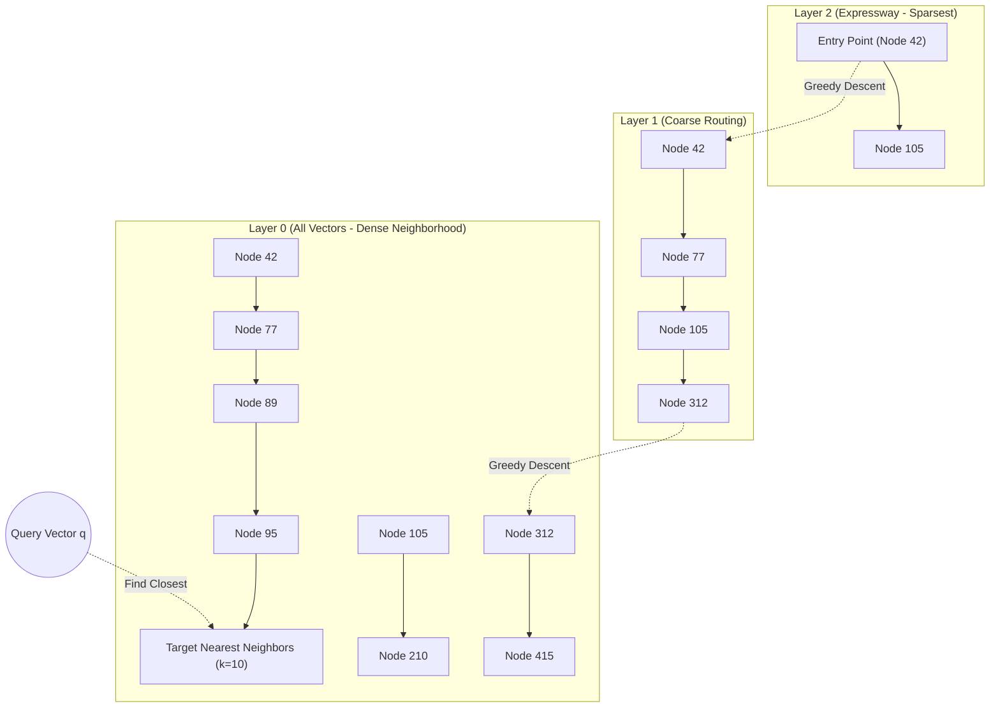
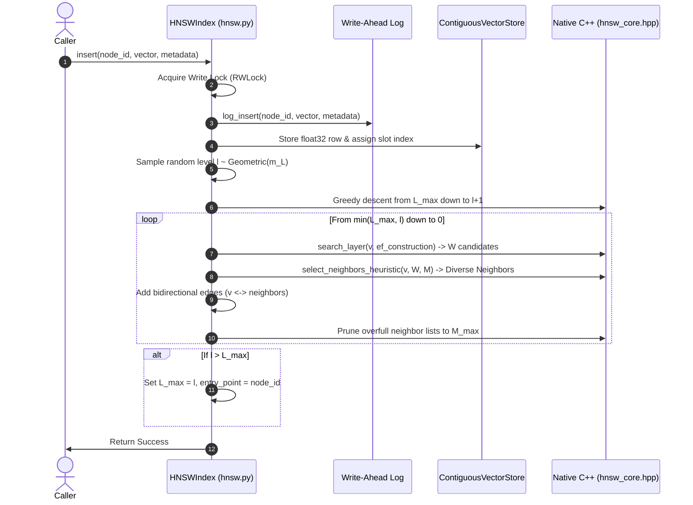

# Architecture Explainer: How Vector Search Works in `vsearch`

This document explains how vector insertion and approximate nearest neighbor (ANN) similarity search work inside `vsearch`. It is written for software engineers and systems programmers with zero prior background in vector indexing. By the end of this 5-minute read, you will understand the data structures, the mathematical intuition, and the exact code paths executing inside this repository.

---

## 1. The Core Problem: Why We Can't Just Brute-Force

When an application searches for semantic matches (e.g. text embeddings or image descriptors), each item is represented as a high-dimensional vector $\mathbf{v} \in \mathbb{R}^D$ (for example, $D = 128$ floating-point numbers).

Given a query vector $\mathbf{q}$ and a collection of $N = 100,000$ stored vectors:
- **Exact Brute-Force Search**: Calculates the Euclidean distance $d(\mathbf{q}, \mathbf{v}) = \sqrt{\sum_{i=1}^D (q_i - v_i)^2}$ against every single vector in storage.
- **The Bottleneck**: At $N = 100,000$ and $D = 128$, one query requires $12.8 \text{ million}$ floating-point multiplications and subtractions. At 1,000 QPS, that requires tens of billions of operations per second—saturating memory bandwidth and CPU pipelines.

To achieve sub-millisecond search at high queries-per-second (QPS), we need an index that finds the nearest neighbors by inspecting only a tiny fraction (e.g. $0.5\% - 2\%$) of the vectors.

---

## 2. The Data Structure: Hierarchical Navigable Small World (HNSW)

The core data structure implemented in `vsearch` is the **Hierarchical Navigable Small World (HNSW)** graph, based on Malkov & Yashunin (2016).

### 2.1 The Multi-Layer Skip-List Analogy
Think of a traditional 1D Skip-List:
- The bottom layer contains every element linked sequentially.
- Higher layers contain progressively fewer elements with wider "express lane" hops, allowing searches to skip large distances in $O(\log N)$ steps before dropping down to find the exact target.

HNSW generalizes this concept to high-dimensional space:
- **Layer 0 (Ground Layer)**: Contains **all** $N$ vectors. Nodes are connected to up to $M_{\text{max0}} = 2M$ neighbors in their immediate geometric vicinity.
- **Upper Layers ($l = 1, 2, \dots, L_{\text{max}}$)**: Contain exponentially fewer vectors ($N \cdot e^{-l / m_L}$). Edges span across large spatial voids, acting as multi-dimensional expressways.



---

## 3. How Search Works: A Code Walkthrough

When a client sends a search request, here is the exact sequence of code executed across the repository:

### Step 1: Entry at the API and Concurrency Control
1. **HTTP Layer** ([`src/vsearch/api/app.py`](file:///src/vsearch/api/app.py)): The FastAPI endpoint `/search` parses `SearchRequest` containing the query vector $\mathbf{q}$, parameter $k$ (number of neighbors), and optional `ef` (exploration queue size).
2. **Read Lock** ([`src/vsearch/hnsw.py:819`](file:///src/vsearch/hnsw.py#L819)): `HNSWIndex.search()` acquires `self.lock.read()` using a custom `RWLock`. Multiple searches execute concurrently without blocking one another.

### Step 2: Coarse Top-Down Greedy Descent (Layers $L_{\text{max}} \dots 1$)
Search starts at `self.entry_point` in the highest layer $L_{\text{max}}$:
1. In each upper layer, the engine performs a **1-greedy search**:
   - Compare distance from $\mathbf{q}$ to the current node vs all its neighbors in that layer.
   - If a neighbor is closer to $\mathbf{q}$ than the current node, step to that neighbor.
   - Repeat until no neighbor is closer (a local minimum for that layer).
2. **Native C++ Acceleration** ([`src/vsearch/hnsw_core.hpp:140`](file:///src/vsearch/hnsw_core.hpp#L140)):
   - Handled by `greedy_search_layer()` in C++: operates directly on contiguous float32 memory pointers with SIMD auto-vectorization.
3. The local minimum found in layer $l$ becomes the entry point for layer $l-1$. This zooms in from a global coordinate space down to the local neighborhood around $\mathbf{q}$ in $O(\log N)$ hops.

### Step 3: Layer 0 Beam Search (`_search_layer`)
Once at Layer 0 (which contains all nodes), the search expands into a **priority-queue-based beam search**:
- **Candidate Queue $C$**: A min-heap ordered by distance (closest candidate explored first).
- **Dynamic Result Queue $W$**: A max-heap of capacity `ef` (default 50) holding the best candidates found so far.
- **Visited Tracking**: An array of bytes `visited[u]` preventing re-evaluation of nodes.

The loop in [`src/vsearch/hnsw_core.hpp:59`](file:///src/vsearch/hnsw_core.hpp#L59) proceeds as follows:
```text
While C is not empty:
  1. Pop candidate 'curr' closest to query q.
  2. If dist(curr, q) > farthest distance in W (and W is full):
        BREAK (no subsequent unvisited neighbor can improve W)
  3. For each neighbor 'n' of 'curr':
        If 'n' not visited:
           mark visited
           compute d = dist(q, n)
           If d < farthest in W (or W not full):
              push 'n' into C
              push 'n' into W
              if size(W) > ef: pop farthest from W
```

### Step 4: Metadata Filtering & Selectivity-Aware Fallback
If the client requested filtered search (e.g. `{"category": "electronics"}`):
1. **Inverted Index Resolution**: `MetadataIndex.get_matching_ids()` looks up allowed node IDs using hash intersections.
2. **Fallback Check**: If matching IDs count $\le 1000$, `HNSWIndex._search_brute_force_matching()` evaluates exact distances directly over the small matching slice, guaranteeing 100% recall.
3. **In-Graph Traversal**: Otherwise, `search_layer` in C++ receives the allowed bitmask: it navigates through non-matching nodes to maintain connectivity, but only admits matching nodes into $W$, terminating within a bounded visit budget.

### Step 5: GIL Release & Thread Safety
In [`src/vsearch/_hnsw_native.pyx`](file:///src/vsearch/_hnsw_native.pyx), `search_layer` executes inside a `with nogil:` block. Python's Global Interpreter Lock is completely released during distance calculations and graph traversal, enabling parallel multi-threaded batch searches.

---

## 4. How Insertion Works: Building the Graph

When inserting a new vector $\mathbf{v}$ with ID `node_id`:



### 4.1 Probabilistic Layer Assignment
The top level $l$ for a new vector is determined probabilistically in `_get_random_level()` ([`src/vsearch/hnsw.py:619`](file:///src/vsearch/hnsw.py#L619)):
$$l = \lfloor - \ln(\text{uniform}(0, 1)) \cdot m_L \rfloor \quad \text{where } m_L = \frac{1}{\ln(M)}$$
Most vectors only exist on Layer 0. Approximately $1/M$ exist on Layer 1, $1/M^2$ on Layer 2, ensuring logarithmic scale depth.

### 4.2 Algorithm 4: Diversity-Aware Neighbor Selection
A naive strategy connects a new node to its $M$ closest neighbors. In real manifold data (like image descriptors), vectors form dense, elongated clusters. Selecting the closest neighbors creates redundant, parallel edges pointing in the same direction, trapping searches in local minima.

To solve this, `vsearch` implements **Malkov & Yashunin (2016) Algorithm 4** in [`src/vsearch/hnsw_core.hpp:185`](file:///src/vsearch/hnsw_core.hpp#L185):
- Candidates are evaluated in ascending order of distance to the base vector $\mathbf{v}$.
- A candidate $\mathbf{e}$ is only connected to $\mathbf{v}$ if it is closer to $\mathbf{v}$ than to *any already-selected neighbor* $\mathbf{r} \in R$:
  $$\forall \mathbf{r} \in R, \quad d(\mathbf{e}, \mathbf{v}) < d(\mathbf{e}, \mathbf{r})$$
- If an existing neighbor is closer to $\mathbf{e}$ than $\mathbf{v}$ is, $\mathbf{e}$ is rejected as geometrically redundant. This enforces angular diversity, ensuring edges radiate in different directions.

---

## 5. Storage & Crash Resilience

Unlike in-memory research prototypes, `vsearch` guarantees crash resilience:
1. **Contiguous Vector Store** ([`src/vsearch/hnsw.py:165`](file:///src/vsearch/hnsw.py#L165)): Vectors are stored in a contiguous 2D float32 memory-mapped array (`mmap`). This allows datasets to exceed RAM size while providing zero-copy pointer access to C++.
2. **Write-Ahead Log (WAL)** ([`src/vsearch/hnsw.py:270`](file:///src/vsearch/hnsw.py#L270)): Every `insert` and `delete` is written to an append-only binary log before being applied to the in-memory graph. If power is interrupted, `HNSWIndex.load_snapshot()` recovers all operations from the last checkpoint.
3. **Tombstone Deletions & Background Compaction** ([`src/vsearch/hnsw.py:440`](file:///src/vsearch/hnsw.py#L440)): Deleted nodes are marked as tombstones so active readers are never interrupted. When tombstones accumulate, `compact()` rebuilds the contiguous arrays and heals graph connectivity.

---

## 6. Summary of Key Files

| File | Purpose | Key Responsibilities |
| :--- | :--- | :--- |
| [`src/vsearch/hnsw.py`](file:///src/vsearch/hnsw.py) | Python Orchestrator | `HNSWIndex`, `MetadataIndex`, persistence, WAL, locking, fallback orchestration |
| [`src/vsearch/hnsw_core.hpp`](file:///src/vsearch/hnsw_core.hpp) | Native C++ Engine | Fast SIMD distances, `search_layer`, `select_neighbors_heuristic`, priority queues |
| [`src/vsearch/_hnsw_native.pyx`](file:///src/vsearch/_hnsw_native.pyx) | Cython Bridge | Direct pointer passing from NumPy buffers to C++, `with nogil:` GIL release |
| [`src/vsearch/api/app.py`](file:///src/vsearch/api/app.py) | REST API | FastAPI endpoints (`/search`, `/vectors`, `/search/batch`, `/stats`), API-key auth |
| [`src/vsearch/client.py`](file:///src/vsearch/client.py) | Python SDK | Ergonomic client (`VSearchClient`) for single and batch operations |
