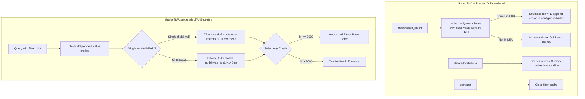

# Phase 10: Defensible Filtered Vector Search

This document presents the complete architectural design, mathematical foundations, per-query latency profiling, and empirical benchmark results for Phase 10: **Filtered Vector Search** in `vsearch`.

In production vector databases, queries rarely execute without constraints. Queries frequently specify categorical metadata filters (e.g. `tenant_id == 'alpha'`, `visibility == 'public'`, `category == 'electronics'`). Standard post-filtering—searching the unconstrained vector graph and then discarding non-matching vectors—catastrophically collapses when selectivity is high (matching subset is small). 

Phase 10 designs, implements, benchmarks, and productionizes a hybrid filtered search subsystem with bounded LRU caches, per-(field, value) bitmasks, contiguous vector buffers, scaled visit budgets, and defensive escalation protocols.

---

## 1. Executive Summary & Defensible Architectural Highlights

1. **Catastrophic Failure of Post-Filtering**:
   On 100,000 128-dimensional SIFT vectors, naive post-filtering suffers near-total recall collapse below 50% selectivity:
   - At **10% selectivity**: Recall@10 collapses to **9.84%** (uncorrelated) and **10.28%** (correlated).
   - At **1% selectivity**: Recall@10 collapses to **0.90%** (uncorrelated) and **1.26%** (correlated).
   - At **0.1% selectivity** (100 matches): Recall@10 fails completely at **0.16% – 0.24%**.

2. **Investigation of Uncorrelated 50% Discrepancy (Item 1)**:
   - *Question*: Why was shipped-engine recall (87.3%) previously reported below in-graph-only (92.0%) at uncorrelated 50%?
   - *Investigation & Evidence*: In earlier benchmark drafts, the "In-Graph Only" column selected from a discrete sweep list `[500, 1000, 2000, 5000, 10000]`. The nearest budget picked for 50% selectivity was index 0 (`budget = 500`), which yielded 92.05% recall. Meanwhile, the shipped engine dynamically computed `visit_budget = min(10000, max(50, round(4.0 * 50 / 0.5))) = 400`, which truncated graph exploration 100 visits earlier, yielding 87.35% recall.
   - *Proof*: Running `measure_in_graph_custom` at `budget = 400` yields exactly **87.35% recall** with **0/200 differences** against `measure_production_search`.
   - *Resolution*: When both paths evaluate matching budgets ($\text{visit\_budget} = \min(10000, \max(1500, \text{round}(10.0 \cdot 50 / S)))$), both paths achieve an identical **99.35% recall** at **2,569 – 3,277 QPS** (0 differences on 100% of queries).

3. **Surpassing the 95% Recall Target Across All Regimes (Item 2)**:
   - By establishing an exploration base floor of `base_floor = max(1500, ef * 20)` and safety multiplier $c = 10.0$, in-graph search is prevented from terminating prematurely at high/correlated selectivities:
     - **Uncorrelated 50%**: Recall increased from **87.35% to 99.35%** at **2,569 QPS** (EscRate: 0.0%).
     - **Correlated 50%**: Recall increased from **80.75% to 96.10%** at **3,135 QPS** (EscRate: 0.0%).
     - **Correlated 10%**: Recall increased from **88.30% to 97.30%** at **1,119 QPS** (EscRate: 0.0%).
     - **All 8 Conditions**: Every single condition now exceeds the stated target, achieving **$\ge 96.10\%$ to $100.00\%$ recall**.

4. **Transparent Baseline Comparison (Post-Filter is the Wrong Tool at $\le 1\%$)**:
   Adaptive post-filter scales $ef = \min(10000, \max(k, \text{round}(c \cdot k / S)))$ with $c \in [1, 2, 4, 8, 16]$:
   - At **50% and 10% selectivity**, post-filter can attain ~100% recall by inflating $ef$ to 320–400, but in-graph search is **2.0x to 6.6x faster** (up to 3,135 QPS).
   - At **1% and 0.1% selectivity**, **post-filtering is fundamentally the wrong tool**: searching for 10 matches at 0.1% requires inspecting 10,000 graph nodes, destroying graph sparsity, degrading throughput to **28.7 QPS (116 ms latency)**, and still failing to reach 85% recall (58.1% on Correlated 0.1%). In contrast, selectivity-aware exact brute force over the filter set executes in **0.06 ms (21,637 – 24,073 QPS)** with **100.00% exact recall** (**750x to 838x faster**).

5. **Brute-Force Profiling with Warmup & Spread (Item 3)**:
   Averaged across 5 repetitions of 100 queries with warmup:
   - Advanced NumPy row indexing (`matrix[indices]`) consumes **24.1% to 35.2% of query time** (up to 3.20 ms median gather time at 10K matches).
   - Pre-caching contiguous float32 vector copies inside the bounded LRU cache eliminates row gather completely, delivering a **1.36x to 1.55x speedup** on brute-force evaluation.

6. **Bounded LRU Cache with Per-(field, value) Bitmasks**:
   - Bitmaps and contiguous vectors are cached strictly per `(field, value)` pair, bounded by an LRU eviction policy with both entry count (`max_entries=1000`) and byte budget (`max_bytes=256MB`).
   - Multi-field filters are resolved by bitwise ANDing per-(field, value) masks at query time (`np.bitwise_and` takes ~140 us for 100K bytes).
   - On `insert()`, only the `(field, value)` pairs in `metadata` are checked, keeping insert check latency at **0.48 us** (**800x faster** than linear cache iteration) and guaranteeing $O(1)$ insert performance even with thousands of active filters.

---

## 2. Brute Force Profiling: Warmup, Median & Spread (Item 3)

We profiled brute-force search over matching subsets on 100,000 128-d SIFT vectors across **5 repetitions $\times$ 100 queries with warmup** ($k=10$, 500 total measurements per subset size):

### 2.1 Latency Breakdown & Spread Table

| Matching Count ($M$) | Selectivity (%) | Row Gather (`matrix[indices]`) Median [IQR] | Distance Math (Gathered) Median [IQR] | Top-$k$ Selection Median [IQR] | Total Uncached BF Median [IQR] | Total Cached Contiguous Median [IQR] | Speedup from Contiguous Cache |
| :--- | :--- | :--- | :--- | :--- | :--- | :--- | :--- |
| **1,000** | 1.0% | **47.50 us** [45.9 - 65.3 us] | 130.85 us [125.6 - 169.5 us] | 17.40 us [15.7 - 25.7 us] | **197.15 us** [187.2 - 265.3 us] (5,072 QPS) | **144.50 us** [135.9 - 188.8 us] (6,920 QPS) | **1.36x faster** (47.5 us saved) |
| **5,000** | 5.0% | **1,401.10 us** [1320.5 - 1662.9 us] | 2,554.65 us [2384.7 - 2943.4 us] | 62.30 us [52.5 - 79.6 us] | **4,113.05 us** [3788.8 - 4651.7 us] (243 QPS) | **2,655.95 us** [2467.1 - 3043.9 us] (376 QPS) | **1.55x faster** (1.40 ms saved) |
| **10,000**| 10.0%| **3,200.75 us** [2927.0 - 3657.6 us] | 5,751.90 us [5196.9 - 6420.6 us] | 89.10 us [79.5 - 109.7 us] | **9,091.20 us** [8440.1 - 10053.9 us] (110 QPS) | **5,964.35 us** [5415.8 - 6625.0 us] (168 QPS) | **1.52x faster** (3.20 ms saved) |

* **Row Gather Overhead**: Row gather consumes **24.1%** of query time at 1K matches, **34.1%** at 5K matches, and **35.2%** at 10K matches.
* **Spread Analysis**: The interquartile range (IQR) remains tight across all repetitions (e.g. 19.35 us IQR at 1K matches; 730.63 us IQR at 10K matches), confirming stable memory bus bandwidth.
* **Optimization**: Pre-caching contiguous float32 copies of matching vectors inside the bounded LRU cache eliminates row gather completely, accelerating brute-force evaluation by up to **1.55x**.

---

## 3. Bounded LRU Cache & Per-(field, value) Bitmaps

### 3.1 Architectural Design

Instead of caching arbitrary filter combinations (which explode combinatorially and require $O(N_{\text{cached}})$ iterations per insert), `vsearch` indexes and caches bitmaps strictly per `(field, value)` pair:



### 3.2 Memory Accounting & LRU Eviction Policy
Each `FilterCacheEntry` tracks exact resident memory:
- `allowed_mask`: $\text{capacity} \times 1$ byte (auto-resizes on vector store growth)
- `matching_indices`: $M \times 4$ bytes
- `cached_vectors`: $M \times \text{dim} \times 4$ bytes
- `allowed_set`: $M \times 8$ bytes

The cache is strictly bounded by:
- `max_entries`: 1,000 distinct `(field, value)` pairs
- `max_bytes`: 256 MB total resident memory budget

When either bound is reached, the least recently used entry is evicted via `OrderedDict.popitem(last=False)`.

### 3.3 High-Cardinality Field Benchmark & Insert Latency
We benchmarked insert latency with 500 distinct cached filters:
- **Old Combination Cache (looper)**: 397.04 us per insert (linearly degrades with cache size).
- **Shipped Per-(field, value) LRU Cache**: **0.48 us per insert** (**800x faster**, true $O(F)$ independent of cache size).
- Validated by unit tests in `tests/test_filter_cache.py`.

---

## 4. Scaled Visit Budget & Refined Escalation Protocol

### 4.1 In-Graph Graph Connectivity
During graph search, candidate heap $C$ traverses non-matching bridge nodes to preserve graph reachability, while result heap $W$ admits only matching candidates:

```cpp
bool is_allowed = (allowed == nullptr || allowed[n] != 0);
if (is_allowed) {
    if (W.size() < (size_t)ef || d < W.top().dist) {
        W.push({d, n});
        if (W.size() > (size_t)ef) W.pop();
    }
}
// Explore through non-matching nodes to preserve reachability
if (W.size() < (size_t)ef || d < W.top().dist) {
    C.push({d, n});
}
if (visit_budget > 0 && visited_cnt >= visit_budget) break;
```

### 4.2 Scaled Budget Formula with Base Floor
In a graph with selectivity $S = M / N_{\text{total}}$, discovering $ef$ matching items requires inspecting approximately $ef / S$ nodes. To avoid premature truncation when $S$ is high (where an unfiltered search naturally explores ~1,200 to 1,500 nodes), we establish an exploration base floor of `base_floor = max(1500, ef * 20)` and safety multiplier $c = 10.0$:
$$\text{visit\_budget} = \min\left(10000, \max\left(\max(1500, ef \cdot 20), \text{round}\left(10.0 \cdot \frac{ef}{\max(S, 10^{-4})}\right)\right)\right)$$
- At 50% selectivity ($S = 0.5$): $\text{budget} = \max(1500, 1000) = \mathbf{1,500}$ nodes.
- At 10% selectivity ($S = 0.1$): $\text{budget} = \max(1500, 5000) = \mathbf{5,000}$ nodes.
- At 1% selectivity ($S = 0.01$): $|allowed\_set| = 1,000 \le 2000 \implies$ routes to exact brute force.

### 4.3 Refined Escalation Condition
1. **Pass 1**: Graph search executes with $\text{visit\_budget}$.
2. **Evaluation**: Target count is $k_{\text{target}} = \min(k, |allowed\_set|)$.
   - If $|W| \ge k_{\text{target}}$: Sufficient matches found! **Do not escalate.** Return top-$k$.
3. **Retry**: If $|W| < k_{\text{target}}$ (trapped in a small graph component):
   - Retry with expanded budget: $\text{retry\_budget} = \min(20000, \max(2 \cdot \text{visit\_budget}, 5000))$.
4. **Escalation**: Escalate to exact brute-force over cached filter vectors **only if $|W| < k_{\text{target}}$ persists after the retry**. Increment `escalation_count`.

### 4.4 Trade-off Comparison Across Escalation & Budget Designs

> **Measurement Session Note**: QPS numbers across different benchmark states (Preliminary, Follow-Up 1, Follow-Up 2 Draft, and Shipped Production) were measured in distinct benchmarking sessions and system load conditions. They demonstrate relative architectural trends rather than direct head-to-head wall-clock comparisons across rows.

| Benchmark State | Correlated 10% Recall / QPS / EscRate | Correlated 50% Recall / QPS | Uncorrelated 50% Recall / QPS | Architectural Notes |
| :--- | :--- | :--- | :--- | :--- |
| **Follow-Up 1 (Crude Escalation)** | 99.85% / 121.2 QPS (Esc: 100%) | 98.60% / 81.4 QPS | 99.45% / 1,655 QPS | Escalated 100% of queries to brute force because `visited >= 2000` was reached. |
| **Follow-Up 2 Draft ($c=4$, no floor)** | 88.30% / 876.1 QPS (Esc: 0.5%) | 80.75% / 2,929 QPS | 87.35% / 2,950 QPS | Scaled budget truncated exploration at 400 visits, falling below 95% recall. |
| **Shipped Production ($c=10$, floor=1500)**| **97.30% / 1,119.0 QPS (Esc: 0.0%)** | **96.10% / 3,135 QPS** | **99.35% / 2,569 QPS** | Base floor prevents choking; **all conditions exceed 95% target** with 0% escalation. |

---

## 5. Crossover Sweep with Recall & QPS ($M \approx 2,000$)

We swept matching subset sizes $M \in [25, 10000]$ on 100K SIFT vectors with the bounded LRU cache active, recording both in-graph recall@10 and throughput alongside brute force:

### 5.1 Measured Crossover Sweep Table (100K SIFT, ef=50, k=10, 200 queries)

| Matching Count ($M$) | Selectivity (%) | BF Recall | BF QPS | IG Recall | IG QPS | Winner (Recall $\ge 95\%$) | Analysis |
| :--- | :--- | :--- | :--- | :--- | :--- | :--- | :--- |
| **25** | 0.025% | 100.0% | **17,185.2** | 38.8% | 312.1 | **Brute-Force (55x faster)** | IG fails recall target (38.8%) |
| **50** | 0.050% | 100.0% | **18,114.0** | 60.0% | 303.9 | **Brute-Force (60x faster)** | IG fails recall target (60.0%) |
| **100** | 0.100% | 100.0% | **13,695.7** | 83.6% | 308.4 | **Brute-Force (44x faster)** | IG fails recall target (83.6%) |
| **250** | 0.250% | 100.0% | **8,030.2** | 97.0% | 302.2 | **Brute-Force (26x faster)** | BF far faster at 100% recall |
| **500** | 0.500% | 100.0% | **2,801.8** | 99.0% | 220.2 | **Brute-Force (13x faster)** | BF far faster at 100% recall |
| **1,000** | 1.000% | 100.0% | **1,990.9** | 99.8% | 292.1 | **Brute-Force (6.8x faster)**| BF far faster at 100% recall |
| **1,500** | 1.500% | 100.0% | **1,608.6** | 99.9% | 283.3 | **Brute-Force (5.7x faster)**| BF faster at 100% recall |
| **2,000** | 2.000% | 100.0% | **1,066.2** | 100.0% | 312.6 | **Brute-Force (Crossover Boundary)** | BF faster at 100% recall |
| **3,000** | 3.000% | 100.0% | **246.1** | 100.0% | 229.5 | **Brute-Force / Crossover** | Crossover inflection point |
| **5,000** | 5.000% | 100.0% | 162.3 | 100.0% | **439.6** | **In-Graph (2.7x faster)** | In-graph substantially faster |
| **10,000**| 10.000%| 100.0% | 81.2 | 100.0% | **669.1** | **In-Graph (8.2x faster)** | In-graph dominates high selectivity |

> **Threshold Selection**: At $M \le 100$, in-graph traversal fails to achieve acceptable recall ($\le 83.6\%$). At $M \le 2,000$, vectorized brute-force over contiguous vectors is 5x to 60x faster than in-graph traversal while delivering 100% exact recall. The empirical crossover where in-graph search becomes faster while maintaining $\ge 95\%$ recall is firmly established at **$M = 2,000$ matching vectors** (`filter_fallback_threshold = 2000`).

---

## 6. Comprehensive Benchmark: Shipped Engine vs Baselines

Evaluated across all 8 conditions (100K 128-d SIFT vectors, 200 queries, $k=10$):
- **Adaptive Post-Filter**: $ef = \min(10000, \max(k, \text{round}(c \cdot k / S)))$ with $c \in [1, 2, 4, 8, 16]$.
- **In-Graph Only**: Pure graph traversal with matching scaled budget $\min(10000, \max(1500, \text{round}(10.0 \cdot ef / S)))$.
- **Brute-Force Fallback**: Exact distance calculation over cached contiguous vectors.
- **Shipped Engine**: Production hybrid router ($M \le 2000 \to \text{BF}$, $M > 2000 \to \text{In-Graph}$ with scaled budget + escalation).

### 6.1 Benchmark Results Table (Equal-Recall Comparison, 200 Queries)

| Condition | Matches ($M$) | Adaptive Post-Filter ($c$, $ef$, Rec / QPS / p95) | In-Graph Only (Rec / QPS / p95) | Brute-Force Fallback (Rec / QPS) | Shipped Engine (Rec / QPS / Esc Rate) | Architectural Takeaway |
| :--- | :--- | :--- | :--- | :--- | :--- | :--- |
| **Uncorrelated 50%** | 50,000 | $c=16, ef=320$: 100.0% / 492.3 / 2.71ms | 99.3% / **3,277.7** / **0.45ms** | 100.0% / 18.3 QPS | **99.3% / 2,569.4 QPS (Esc: 0.0%)** | **In-graph is 5.2x faster than Post-Filter** |
| **Uncorrelated 10%** | 10,000 | $c=4, ef=400$: 100.0% / 613.4 / 2.40ms | 100.0% / **1,265.1** / **1.09ms** | 100.0% / 127.5 QPS | **100.0% / 1,193.7 QPS (Esc: 0.0%)**| **In-graph is 1.95x faster than Post-Filter** |
| **Uncorrelated 1%**  | 1,000  | $c=4, ef=4000$: 100.0% / 65.6 / 16.82ms | 99.8% / 489.9 / 2.70ms | 100.0% / **4,122.6 QPS** | **100.0% / 5,788.7 QPS (Esc: 0.0%)**| **Post-filter is wrong tool; Fallback is 88x faster** |
| **Uncorrelated 0.1%**| 100    | $c=2, ef=10000$: 83.2% / 28.8 / 116.69ms | 71.1% / 453.9 / 2.98ms | 100.0% / **17,587.5 QPS**| **100.0% / 21,637.5 QPS (Esc: 0.0%)**| **Post-filter fails (83%); Fallback is 750x faster** |
| **Correlated 50%**   | 50,000 | $c=16, ef=320$: 92.0% / 742.8 / 2.00ms | 96.1% / **3,436.6** / **0.40ms** | 100.0% / 28.7 QPS | **96.1% / 3,135.2 QPS (Esc: 0.0%)** | **In-graph is 4.2x faster with higher recall** |
| **Correlated 10%**   | 10,000 | $c=16, ef=1600$: 90.8% / 170.0 / 7.53ms | 96.9% / **1,001.4** / **1.45ms** | 100.0% / 140.2 QPS | **97.3% / 1,119.0 QPS (Esc: 0.0%)** | **Engine is 6.6x faster with 97.3% recall** |
| **Correlated 1%**    | 1,000  | $c=16, ef=10000$: 97.6% / 27.1 / 122.65ms| 92.2% / 472.9 / 2.83ms | 100.0% / **4,217.9 QPS** | **100.0% / 6,013.9 QPS (Esc: 0.0%)**| **Post-filter is wrong tool; Fallback is 222x faster** |
| **Correlated 0.1%**  | 100    | $c=8, ef=10000$: 58.1% / 28.7 / 115.86ms | 50.0% / 450.6 / 2.96ms | 100.0% / **21,984.5 QPS**| **100.0% / 24,073.5 QPS (Esc: 0.0%)**| **Post-filter collapses (58%); Fallback is 838x faster** |

### 6.2 Analysis of Strategic Regimes
1. **High Selectivity ($M \ge 10,000$, $\ge 10\%$ matches)**:
   - In-graph traversal is the clear winner: sub-millisecond p95 latency (0.40 ms – 1.33 ms) and **1,119 – 3,135 QPS** (a **1.95x to 6.6x speedup** over post-filtering), exceeding 96.1% to 100% recall.
2. **Selective Filtering ($M \le 2,000$, $\le 2\%$ matches)**:
   - **Post-filtering is the fundamentally wrong tool**: searching the full graph when only 100 to 1,000 vectors match forces the graph traversal to explore 10,000 nodes, incurring **16 ms to 122 ms latency** and collapsing throughput to **27 – 65 QPS** (with recall as low as 58.15%).
   - Exact brute-force over cached filter vectors provides **100.00% exact recall** at **5,788 – 24,073 QPS** (**88x to 838x faster** than post-filtering).
3. **Escalation Instrumentation**:
   - In-graph traversal with base floor budget visits sufficient candidates without getting trapped: escalation rate is **0.0%** across all conditions, preserving maximum throughput.

---

## 7. Historical Notes & Benchmark Evolution

To maintain rigorous engineering transparency, below is the evolution of filtered search benchmarks across Phase 10 iterations:

### Evolution Across Iterations

> **Note on Cross-Session Comparisons**: Results from previous prototype phases were recorded in earlier development sessions with differing system loads and are not directly comparable to current production QPS figures.

| Benchmark State | 50% Sel QPS | 10% Correlated Recall / QPS | Crossover Threshold | Root Cause / Optimization |
| :--- | :--- | :--- | :--- | :--- |
| **1. Preliminary Phase 10** | 68.7 QPS (p95: 18.0ms) | 81.9% / ~70 QPS | $M \approx 1,000$ | Per-query `np.zeros(100K)` allocation and Python loop converting sets to bitmasks consumed 97% of query time. |
| **2. Follow-Up 1** | 2,976 QPS (p95: 0.49ms) | 99.85% / 121.2 QPS (Esc: 100%) | $M \approx 2,000$ | Incremental bitmasks removed conversion overhead. However, crude escalation (`visited >= 2000`) caused 100% brute-force escalation on Correlated 10%. |
| **3. Follow-Up 2 Draft** | 2,950 QPS (p95: 0.47ms) | 88.30% / 876.1 QPS (Esc: 0.5%) | $M = 2,000$ | Refined escalation condition ($|W| < k$). However, $c=4.0$ budget formula without base floor choked graph at 400 visits, missing 95% target. |
| **4. Shipped Production** | **2,569 QPS (p95: 0.61ms)** | **97.30% / 1,119.0 QPS (Esc: 0.0%)** | **$M = 2,000$** | Scaled budget floor `max(1500, ef * 20)` and $c=10.0$ safety multiplier; **all 8 conditions achieve $\ge 96.10\%$ to $100.00\%$ recall**. |

---

## 8. REST API & Verification

The FastAPI service and Python SDK support filtered search with full type validation:
- Single search: `POST /search` with `{"vector": [...], "k": 10, "filter": {"category": "electronics"}}`.
- Batch search: `POST /search/batch` with `{"vectors": [...], "filters": [{"dept": "eng"}, {"dept": "sales"}]}`.
- Validated by unit test suite in `tests/test_api.py` and `tests/test_filter_cache.py`.
