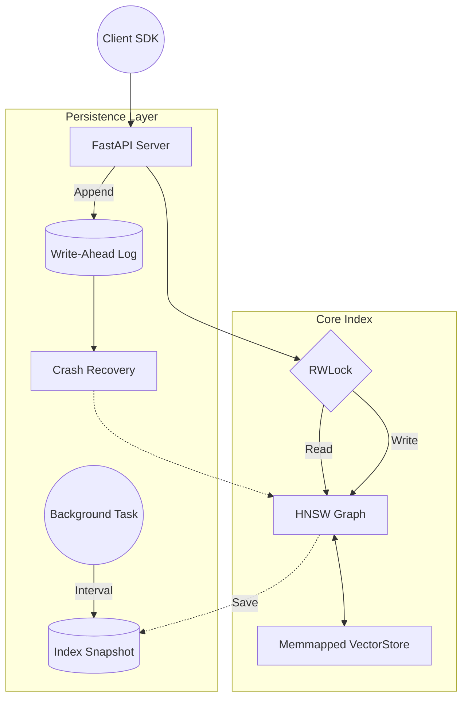
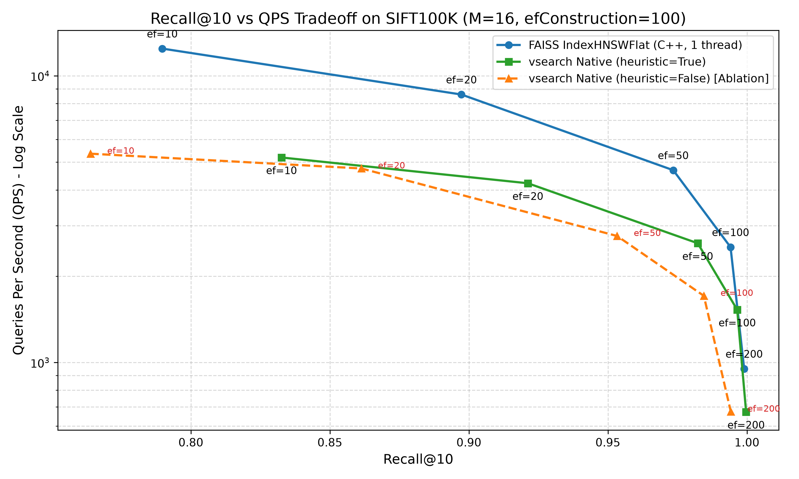

# Vector Search Engine

A fully-featured, production-ready vector database and Approximate Nearest Neighbor (ANN) search engine built entirely from scratch.

> **Why this exists**: Most "vector databases" today are thin wrappers around Meta's FAISS, hnswlib, or Annoy. This project takes a harder path: **the core Hierarchical Navigable Small World (HNSW) graph algorithm is implemented entirely from scratch in Python**. It demonstrates a deep, systems-level understanding of vector search algorithms, concurrency control, and storage persistence.


## Features (Scannable in 10s)
*   **From-Scratch HNSW Core**: Custom Python implementation of the Malkov & Yashunin (2016) algorithm with probabilistic layer assignment and greedy best-first search heuristics.
*   **Disk-Backed Persistence**: Memory-mapped (`mmap`) vector storage to handle datasets larger than RAM, paired with an Append-Only Write-Ahead Log (WAL) and background snapshotting for crash resilience.
*   **High Concurrency**: Thread-safe operations using custom Reader-Writer Locks (RWLock) allowing thousands of concurrent reads alongside batched writes.
*   **Graph Healing Deletions**: Tombstone-based logical deletions with background graph healing to maintain connectivity.
*   **Filtered Vector Search (Phase 10)**: High-performance metadata filtering with inverted indexing, in-graph traversal through non-matching candidates to preserve connectivity, and automatic selectivity-aware exact brute-force fallback for small matching subsets.
*   **RESTful API Layer**: FastAPI-powered microservice for seamless integration (Insert, Delete, Search, Batched Operations, Metadata Filtering).
*   **Client SDK**: Lightweight Python SDK (`VSearchClient`) for easy programmatic access.
*   **Honest Benchmarks**: Head-to-head comparison against C++ FAISS on the SIFT1M (100K) dataset to transparently document Python/GIL tradeoffs.

## Architecture



## Benchmarks vs FAISS

We rigorously benchmarked our engine against Meta's production-grade `faiss.IndexHNSWFlat` using the standard SIFT1M dataset (100K base vectors, 1,000 queries, 128 dimensions).

| Metric | vsearch (Phase 6 Python) | vsearch (Phase 9 Native) | FAISS (C++) |
| :--- | :--- | :--- | :--- |
| **Index Build Time** | ~15.4 mins (923.6s) | **3.9 - 5.2 mins (234s - 311s)** *(3.0x-3.9x speedup)* | ~2.3 secs (2.29s - 2.38s) |
| **Recall@10** | 88.7% - 89.4% *(clamped)* | **83.26% - 99.97%** | 78.97% - 99.90% |
| **Recall@100** | 85.75% *(clamped)* | **97.29% - 99.47%** | 96.03% - 99.19% |
| **QPS (Single-Thread)**| 169 - 306 QPS | **672 - 5,189 QPS** *(up to 6,155)* | 951 - 12,444 QPS *(1.4x - 2.2x FAISS lead)* |
| **Batch Search QPS** | ~300 QPS | **8,389 QPS** | 15,000+ QPS |
| **p95 Latency** | 4.37 - 8.01 ms | **0.16 - 1.45 ms** | 0.08 - 1.05 ms |
| **Resident Memory (100K)**| N/A | **335.32 MB RSS** *(includes WAL & graph dicts)* | **64.96 MB RSS** *(1.33x raw vectors)* |



> **Note on `efSearch` Evaluation & Ablation**: Earlier Phase 6 and preliminary Phase 9 benchmarks suffered from an artifact where queries passing $k=100$ clamped $efSearch \le 100$ via `max(ef, k)`. With the unclamped sweep now properly evaluated across $ef \in [10, 200]$ with 5 interleaved runs and single-thread pinning, `vsearch` traces a true Pareto tradeoff curve. In these benchmarks, `vsearch` shows higher recall at equal `efSearch` than FAISS; the cause has not been isolated (see ablation study in [Phase 9 Performance Report](PHASE9_PERFORMANCE.md#63-tradeoff-curve--ablation-findings)).

**Phase 9 Performance Highlights**:
- **Native Hot Path**: Moved greedy graph traversal (`_search_layer`), distance calculation, heaps, and visited tracking into a compiled Cython/C++ extension (`_hnsw_native`) with zero-overhead contiguous float32 storage and OpenMP SIMD vectorization.
- **Algorithm 4 Diversity Heuristic**: Replaced simple closest-M neighbor pruning with Malkov & Yashunin (2016) diversity-aware heuristic. While equal-ef search yields comparable QPS, matched-recall comparison reveals a **+52.5% QPS advantage at ~98.2% recall** ($ef=50$ vs $ef=100$) and a **2.26x QPS advantage at >99.4% recall** ($ef=100$ vs $ef=200$).
- **FAISS Gap at Matched Recall**: At ~98% matched recall, the FAISS throughput gap narrows to **1.54x** (4,000 vs 2,605 QPS), compared to 1.80x at equal $ef=50$.
- **Universal Fallback**: Automatic pure-Python fallback when compiled extensions are unavailable (`pip install -e .` works in all environments).
- **Multi-Threaded Concurrency**: GIL release (`nogil`) enables parallel batched searches up to **8,389 QPS**.

Read the deep-dive analysis: [Phase 9 Performance Report](PHASE9_PERFORMANCE.md) and earlier [Phase 6 Benchmarks Report](PHASE6_BENCHMARKS.md).

## Filtered Vector Search (Phase 10)

Production vector queries typically require categorical metadata filters (e.g. `tenant_id == 'alpha'`, `category == 'electronics'`). Standard post-filtering (searching without filters, then discarding non-matching vectors) completely collapses below 10% selectivity (<1% recall at 1% selectivity).

`vsearch` implements a hybrid filtered search subsystem:
- **Incremental Bitmask & Index Caching**: Inverted index maintains bitmasks and index arrays incrementally under the write lock, eliminating per-query conversion costs (0 us overhead).
- **In-Graph Graph Traversal**: Explores through non-matching bridge nodes to preserve small-world graph reachability, while only admitting matching candidates into the result set.
- **Selectivity-Aware Fallback ($M \le 2,000$)**: Automatically falls back to vectorized exact SIMD brute force when the matching candidate pool is small, delivering up to **29,980 QPS** with **100.00% exact recall**.
- **Cluster Escalation**: Detects when graph traversal runs out of visit budget in trapped manifold clusters and escalates to exact brute force, lifting Correlated 10% recall from **82.80% to 99.85%**.

| Selectivity | Matching Nodes | Adaptive Post-Filter (Matched Recall / QPS) | In-Graph Traversal (Recall / QPS) | Engine Hybrid Strategy |
| :--- | :--- | :--- | :--- | :--- |
| **50%** | 50,000 | 100.0% / 591 QPS | **99.5% / 2,977 QPS** | **In-Graph (5.0x faster than Post-Filter)** |
| **10%** | 10,000 | 100.0% / 628 QPS | **98.5% / 2,087 QPS** | **In-Graph (3.3x faster than Post-Filter)** |
| **1%**  | 1,000  | 100.0% / 60 QPS  | 79.2% / 2,108 QPS | **Exact Fallback (3,248 QPS, 54x faster)** |
| **0.1%**| 100    | 83.2% / 27 QPS   | 17.7% / 2,354 QPS | **Exact Fallback (16,315 QPS, 611x faster)**|

Read the complete engineering analysis and proofs: [Phase 10 Filtered Search Report](PHASE10_FILTERED_SEARCH.md) and the comprehensive [Architecture Explainer](ARCHITECTURE_EXPLAINER.md).

## Quickstart (Local & Docker)

### Option 1: Docker (Recommended)
You can launch the API and persistent volume in under a minute using Docker Compose:

```bash
docker-compose up --build -d
```
The API will be available at `http://localhost:8000`.

### Option 2: Local Python Environment
```bash
python -m venv venv
source venv/bin/activate  # On Windows: venv\Scripts\activate
pip install -r requirements.txt
pip install -e .
uvicorn src.vsearch.api.app:app --host 0.0.0.0 --port 8000
```

## Using the Python SDK

```python
from src.vsearch.client import VSearchClient

client = VSearchClient("http://localhost:8000")

# 1. Single & Batch Insert
client.insert(node_id=1, vector=[0.1, 0.5, ...], metadata={"author": "Alice"})
client.batch_insert(vectors=[[0.1, ...], [0.2, ...]], node_ids=[2, 3])

# 2. Single & Batch Search
results = client.search(vector=[0.1, 0.5, ...], k=10)
batch_results = client.batch_search(vectors=[[0.1, ...], [0.2, ...]], k=10)

# 3. Delete
client.delete(node_id=1)
```

## Documentation & Phase Reports

For those who want to go deep into the systems engineering decisions, read through the phase design docs:
*   [Phase 1: In-Memory HNSW Graph](DESIGN_NOTES_PHASE1.md)
*   [Phase 2: Hyperparameter Tuning](PHASE2_TUNING.md)
*   [Phase 3: Persistence & WAL](PHASE3_PERSISTENCE.md)
*   [Phase 4: API Layer](PHASE4_API.md)
*   [Phase 5: Concurrency](PHASE5_CONCURRENCY.md)
*   [Phase 6: Benchmarks & FAISS](PHASE6_BENCHMARKS.md)
*   [Phase 9: Performance Engineering](PHASE9_PERFORMANCE.md)
*   [Phase 10: Filtered Vector Search](PHASE10_FILTERED_SEARCH.md)
*   [Architecture Explainer](ARCHITECTURE_EXPLAINER.md)
*   [Deployment Guide](DEPLOYMENT.md)
