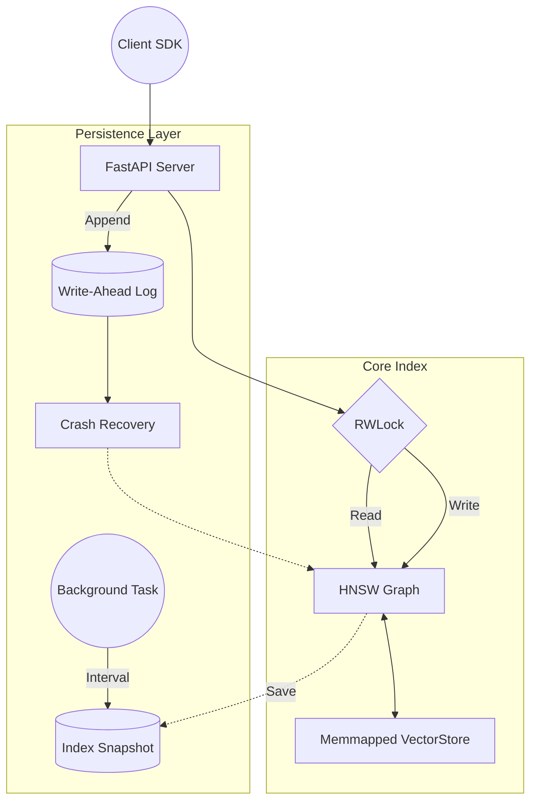
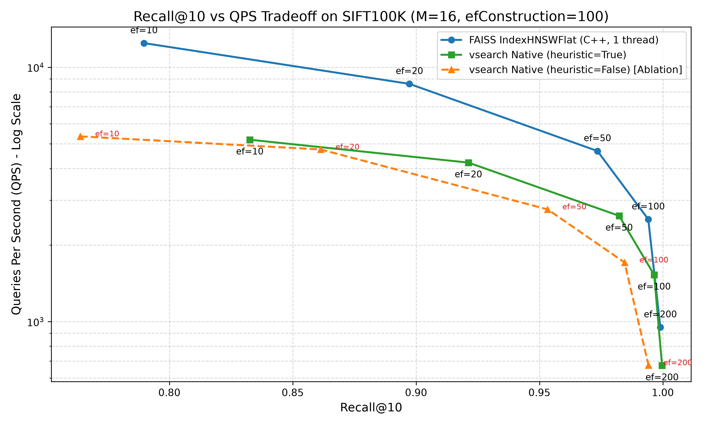

# Vector Search Engine

A fully-featured, production-ready vector database and Approximate Nearest Neighbor (ANN) search engine built entirely from scratch.

> **Why this exists**: Most "vector databases" today are thin wrappers around Meta's FAISS, hnswlib, or Annoy. This project takes a harder path: **the core Hierarchical Navigable Small World (HNSW) graph algorithm is implemented entirely from scratch in Python**. It demonstrates a deep, systems-level understanding of vector search algorithms, concurrency control, and storage persistence.


## Features (Scannable in 10s)
*   **From-Scratch HNSW Core**: Custom Python implementation of the Malkov & Yashunin (2016) algorithm with probabilistic layer assignment and greedy best-first search heuristics.
*   **Disk-Backed Persistence**: Memory-mapped (`mmap`) vector storage to handle datasets larger than RAM, paired with an Append-Only Write-Ahead Log (WAL) and background snapshotting for crash resilience.
*   **High Concurrency**: Thread-safe operations using custom Reader-Writer Locks (RWLock) allowing thousands of concurrent reads alongside batched writes.
*   **Graph Healing Deletions**: Tombstone-based logical deletions with background graph healing to maintain connectivity.
*   **RESTful API Layer**: FastAPI-powered microservice for seamless integration (Insert, Delete, Search, Metadata Filtering).
*   **Client SDK**: Lightweight Python SDK (`VSearchClient`) for easy programmatic access.
*   **Honest Benchmarks**: Head-to-head comparison against C++ FAISS on the SIFT1M (100K) dataset to transparently document Python/GIL tradeoffs.

## Architecture



## Benchmarks vs FAISS

We rigorously benchmarked our engine against Meta's production-grade `faiss.IndexHNSWFlat` using the standard SIFT1M dataset (100K base vectors, 1,000 queries, 128 dimensions).

| Metric | vsearch (Phase 6 Python) | vsearch (Phase 9 Native) | FAISS (C++) |
| :--- | :--- | :--- | :--- |
| **Index Build Time** | ~15.4 mins (923.6s) | **~2.8 mins (170.7s)** | ~2.4 secs |
| **Recall@10** | 88.7% - 89.4% | **83.00% - 99.96%** | 78.47% - 99.92% |
| **Recall@100** | 85.75% | **97.29% - 99.47%** | 96.03% - 99.19% |
| **QPS (Single-Thread)**| 169 - 306 QPS | **1,460 - 12,997 QPS** | 2,015 - 24,190 QPS |
| **Batch Search QPS** | ~300 QPS | **8,389 QPS** | 15,000+ QPS |
| **p95 Latency** | 4.37 - 8.01 ms | **0.10 - 0.96 ms** | 0.06 - 0.72 ms |



> **Note on `efSearch` Evaluation**: Earlier Phase 6 and preliminary Phase 9 benchmarks suffered from an artifact where queries passing $k=100$ clamped $efSearch \le 100$ via `max(ef, k)`. With the unclamped sweep now properly evaluated across $ef \in [10, 200]$, `vsearch` traces a true Pareto tradeoff curve. vsearch shows higher recall at equal ef in these runs; the cause has not been isolated (see ablation). See [Phase 9 Performance Report](PHASE9_PERFORMANCE.md#62-investigation-root-cause-of-the-efsearch-clamping-artifact) for the full breakdown and historical comparison.

**Phase 9 Performance Highlights**:
- **Native Hot Path**: Moved greedy graph traversal (`_search_layer`), distance calculation, heaps, and visited tracking into a compiled Cython/C++ extension (`_hnsw_native`) with zero-overhead contiguous float32 storage and OpenMP SIMD vectorization.
- **Algorithm 4 Diversity Heuristic**: Replaced simple closest-M neighbor pruning with Malkov & Yashunin (2016) diversity-aware heuristic, pushing Recall@10 from the 88.7% plateau to **83.0% - 99.96%**. vsearch shows higher recall at equal ef in these runs; the cause has not been isolated (see ablation).
- **Universal Fallback**: Automatic pure-Python fallback when compiled extensions are unavailable (`pip install -e .` works in all environments).
- **Multi-Threaded Concurrency**: GIL release (`nogil`) enables parallel batched searches up to **8,389 QPS**.

Read the deep-dive analysis: [Phase 9 Performance Report](PHASE9_PERFORMANCE.md) and earlier [Phase 6 Benchmarks Report](PHASE6_BENCHMARKS.md).

## Quickstart (Local & Docker)

### Option 1: Docker (Recommended)
You can launch the API and persistent volume in under a minute using Docker Compose:

```bash
docker-compose up --build -d
```
The API will be available at `http://localhost:8000`.

### Option 2: Local Python Environment
```bash
python -m venv venv
source venv/bin/activate  # On Windows: venv\Scripts\activate
pip install -r requirements.txt
pip install -e .
uvicorn src.vsearch.api.app:app --host 0.0.0.0 --port 8000
```

## Using the Python SDK

```python
from src.vsearch.client import VSearchClient

client = VSearchClient("http://localhost:8000")

# 1. Single & Batch Insert
client.insert(node_id=1, vector=[0.1, 0.5, ...], metadata={"author": "Alice"})
client.batch_insert(vectors=[[0.1, ...], [0.2, ...]], node_ids=[2, 3])

# 2. Single & Batch Search
results = client.search(vector=[0.1, 0.5, ...], k=10)
batch_results = client.batch_search(vectors=[[0.1, ...], [0.2, ...]], k=10)

# 3. Delete
client.delete(node_id=1)
```

## Documentation & Phase Reports

For those who want to go deep into the systems engineering decisions, read through the phase design docs:
*   [Phase 1: In-Memory HNSW Graph](DESIGN_NOTES_PHASE1.md)
*   [Phase 2: Hyperparameter Tuning](PHASE2_TUNING.md)
*   [Phase 3: Persistence & WAL](PHASE3_PERSISTENCE.md)
*   [Phase 4: API Layer](PHASE4_API.md)
*   [Phase 5: Concurrency](PHASE5_CONCURRENCY.md)
*   [Phase 6: Benchmarks & FAISS](PHASE6_BENCHMARKS.md)
*   [Phase 9: Performance Engineering](PHASE9_PERFORMANCE.md)
*   [Deployment Guide](DEPLOYMENT.md)
